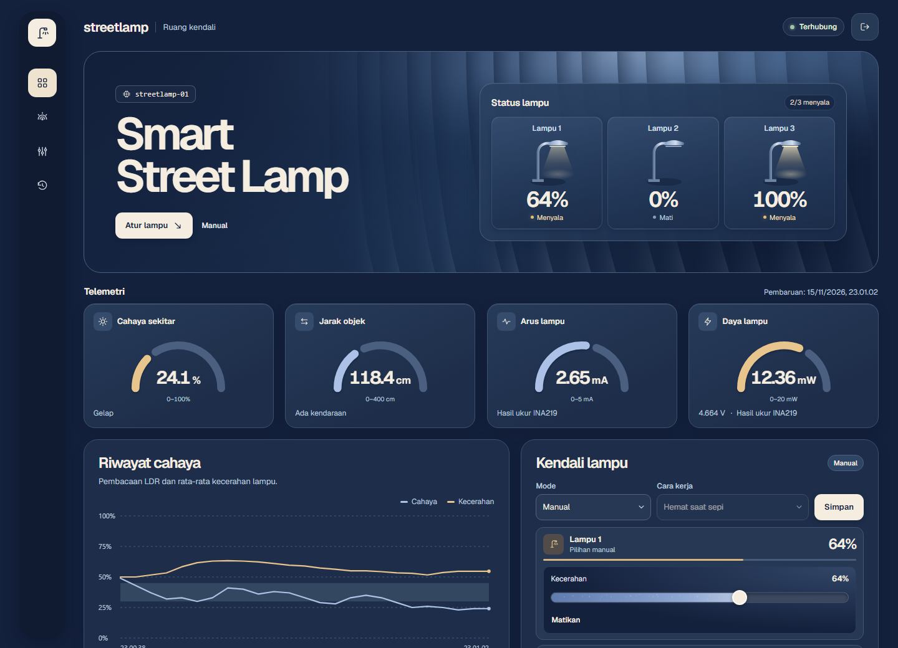
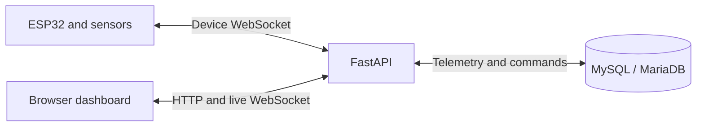

<h1 align="center">Smart Street Lamp</h1>

<p align="center">Live telemetry and independent brightness control for three ESP32-controlled street lamps.</p>

<p align="center">
  <a href=".python-version"></a>
  <a href="platformio.ini"></a>
  <a href="LICENSE"></a>
</p>

<p align="center">
  <a href="#quick-start">Quick start</a> ·
  <a href="#connect-an-esp32">Hardware</a> ·
  <a href="#data-flow">Data flow</a> ·
  <a href="#tests">Tests</a>
</p>



*Dashboard preview with sample telemetry.*

## Features

- See ambient light, object distance, bus voltage, lamp current, and lamp power from one dashboard.
- View the brightness reported by each lamp, recent sensor readings, and the status of saved commands.
- Choose an automatic lighting profile or set each lamp's PWM duty cycle from 0% to 100%.

| Mode | Lamp behavior |
| --- | --- |
| Adaptive | With a valid distance reading, detected vehicles bring the lamps to 100% in darkness. When the road clears, the lamps hold at 100% for 10 seconds and fade to 50% over the next 10 seconds. In daylight, they switch off. |
| Light only | Switches the lamps on in darkness and off in daylight. |
| Manual | Sets the brightness of each lamp independently. |

## Quick start

Use **Python 3.11** and a running **MySQL or MariaDB** instance. On Windows, start MySQL from the XAMPP Control Panel and open PowerShell in the repository root.

### Install and configure

```powershell
py -3.11 -m venv .venv
.\.venv\Scripts\python.exe -m pip install -r requirements.txt
.\.venv\Scripts\python.exe scripts/configure.py
.\.venv\Scripts\python.exe scripts/setup_mysql.py
```

`configure.py` creates a local `.env`. The database setup script uses `root` by default and reads `MYSQL_ADMIN_PASSWORD` from the environment when needed. Set `MYSQL_PASSWORD` to the existing application account's password if that account has already been created.

> [!IMPORTANT]
> Keep the existing `.env` when reconnecting a flashed ESP32. If you need to recreate it, start from [`.env.example`](.env.example) and set the device's existing `DEVICE_ID` and `DEVICE_TOKEN` before running `configure.py`.

### Start the dashboard

```powershell
.\.venv\Scripts\python.exe -m uvicorn server.app:create_app --factory --host 127.0.0.1 --port 8000
```

Open the [local dashboard](http://127.0.0.1:8000/) and sign in with `DASHBOARD_USERNAME` and `DASHBOARD_PASSWORD` from `.env`. Use the [health endpoint](http://127.0.0.1:8000/health) to check the database connection.

## Connect an ESP32

Stop the loopback server and start it with the LAN binding. Connect the ESP32 to the same network as the server.

```powershell
.\.venv\Scripts\python.exe -m uvicorn server.app:create_app --factory --host 0.0.0.0 --port 8000
```

Set `SERVER_IP` in [`proyek.cpp`](proyek.cpp) to the server host's LAN IPv4 address. Set the device ID and token to the values in the server's `.env`. For a fresh flash, set the Wi-Fi credentials in the same firmware configuration block and keep credential edits local.

With PlatformIO Core installed and the ESP32 connected over USB, build and upload with the [esp32dev environment](platformio.ini).

```powershell
pio run --environment esp32dev
pio run --environment esp32dev --target upload
```

| Component | Firmware pins | Purpose |
| --- | --- | --- |
| LDR | GPIO34 | Analog ambient light reading |
| HC-SR04 | Trigger GPIO19, echo GPIO18 | Distance and vehicle detection |
| INA219 | SDA GPIO22, SCL GPIO21 | Voltage, current, and power |
| Lamps 1–3 | GPIO25, GPIO26, GPIO27 | Independent PWM outputs |

<details>
<summary>The dashboard shows the ESP32 as offline</summary>

1. Open `http://<server-lan-ip>:8000/health` from another device on the same network.
2. Check the server address, port, device ID, and token in the flashed firmware.
3. Inspect the ESP32's serial diagnostics at 115200 baud.

</details>

## Data flow



The ESP32 requests a boot ID and sends telemetry about once per second over its WebSocket. FastAPI validates the report, stores it in MySQL, and pushes it to the browser. When a command is saved, the dashboard marks it as applied after the ESP32 acknowledges it with matching settings.

The dashboard marks telemetry as stale after 15 seconds while keeping the last reading visible. Unconfirmed commands expire after 30 seconds. After 30 seconds without server contact, the ESP32 falls back to adaptive lighting from remote manual or light-only control.

### API at a glance

| Endpoint | Purpose |
| --- | --- |
| `GET /health` | Check the database connection |
| `POST /api/login` | Start a dashboard session |
| `GET /api/state` | Read the current device state and recent commands |
| `GET /api/history` | Load stored telemetry |
| `WS /api/live` | Receive snapshots and live updates in the dashboard |
| `POST /api/commands` | Send a lighting command |
| `POST /api/devices/{device_id}/boot` | Request an ESP32 boot ID |
| `WS /api/devices/{device_id}/live` | Send device telemetry and receive commands |
| `POST /api/devices/{device_id}/sync` | Use the HTTP telemetry and command fallback |

Sign-in creates a signed session cookie for dashboard access. Device routes authenticate with a bearer token.

## Tests

Start MySQL and run the API suite from the repository root. The tests use a separate schema ending in `_test`.

```powershell
.\.venv\Scripts\python.exe -m pip install -r requirements-dev.txt
.\.venv\Scripts\python.exe scripts/setup_mysql.py --include-test
.\.venv\Scripts\python.exe -m unittest discover -s tests -v
```

## Project files

| Path | Contents |
| --- | --- |
| [`proyek.cpp`](proyek.cpp) | ESP32 sensors, PWM control, and networking |
| [`server/`](server/) | FastAPI application, MySQL schema, and dashboard |
| [`diagram.json`](diagram.json) | Original Wokwi circuit reference |
| [`docs/`](docs/) | [Project background](docs/PROJECT.md), [system diagrams](docs/diagrams/), and [deployment options](docs/DEPLOYMENT.md#hosting-gratis) |

## License

The project is available under the [MIT License](LICENSE).
